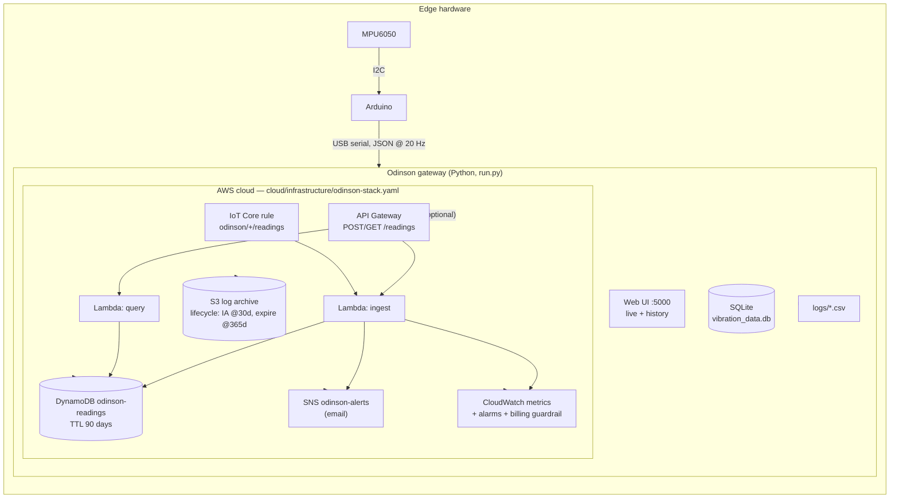

# Odinson — IoT Vibration & Seismic Monitor


A low-cost digital seismometer: an **MPU6050** on an **Arduino** streams 3-axis acceleration to a
**Python gateway**, which detects abnormal vibration with an adaptive baseline, shows a live dashboard,
persists history, fires alerts — and ships everything to **AWS** (DynamoDB, Lambda, API Gateway, SNS,
CloudWatch, S3, IoT Core), all provisioned as code with a single **CloudFormation** template.

Built by Yogesh, Angel, Tanjil & Sashrika.

---

## Architecture



## Features

- **Edge firmware** (`arduino/`): MPU6050 calibration at boot, JSON-lines output at 20 Hz / 115200 baud
  (legacy CSV format still parsed for backward compatibility).
- **Detection** (`odinson/detector.py`): acceleration magnitude → exponentially-weighted adaptive baseline
  → deviation (`delta`); edge-triggered alert latch so one event = one notification, not 20.
- **Local gateway** (`run.py`): serial reader with auto-reconnect and automatic mock fallback,
  SQLite + CSV persistence, Telegram + sound alerts, Flask web UI + JSON API, optional matplotlib live plot.
- **AWS cloud bridge** (`odinson/cloud/aws_bridge.py`): every reading → DynamoDB, alerts → SNS,
  metrics → CloudWatch, CSV logs → S3. Fail-safe: cloud outages never interrupt local monitoring.
- **Infrastructure as code** (`cloud/`): SAM/CloudFormation stack (DynamoDB + TTL + PITR, S3 with
  encryption/public-block/lifecycle, SNS + email subscription, 2 Lambdas, HTTP API, IoT Core rule,
  CloudWatch alarm, **$1 billing guardrail alarm**), least-privilege IAM policy for the gateway,
  ready-to-import CloudWatch dashboard.
- **Engineering hygiene**: pytest suite, ruff lint, GitHub Actions CI, Docker + docker-compose,
  LocalStack profile for **$0 local AWS emulation**, `.env`-based config (no secrets in code),
  free-tier-safe defaults.

## Quickstart

### 1. Demo without hardware (mock mode)

```bash
pip install -r requirements.txt
python run.py --mock
# open http://localhost:5000
```

### 2. With hardware

| MPU6050 | Arduino |
|---------|---------|
| VCC     | 3.3V    |
| GND     | GND     |
| SDA     | SDA     |
| SCL     | SCL     |

1. Install the **MPU6050** library in Arduino IDE and upload `arduino/mpu6050_reader/mpu6050_reader.ino`.
2. Copy `.env.example` to `.env`, set `ODINSON_SERIAL_PORT` (e.g. `COM3` on Windows, `/dev/ttyUSB0` on Linux).
3. `python run.py` — web UI on http://localhost:5000, matplotlib window on desktop.

### 3. Docker

```bash
docker compose up --build     # mock mode inside the container
```

## AWS deployment (free-tier friendly)

Everything below stays within the AWS Free Tier at this project's scale
(DynamoDB 25 WCU + 25 GB and Lambda 1M requests/month are **permanent** free tier;
API Gateway/S3/IoT Core have generous 12-month tiers; DynamoDB TTL + S3 lifecycle keep
storage bounded; a $1 billing alarm emails you if anything ever drifts).

```bash
# 1. Deploy the stack (SAM packages the Lambda code automatically)
aws cloudformation deploy \
  --template-file cloud/infrastructure/odinson-stack.yaml \
  --stack-name odinson \
  --capabilities CAPABILITY_IAM \
  --parameter-overrides AlertEmail=you@example.com

# 2. Confirm the SNS subscription email you receive.

# 3. Create a least-privilege IAM user for the gateway and note its keys
#    (attach cloud/iam/odinson-gateway-policy.json as an inline policy).

# 4. Fill .env from the stack outputs (AlertsTopicArn, LogBucketName) + your AWS creds:
#    ODINSON_AWS_ENABLED=true, ODINSON_SNS_TOPIC_ARN=..., ODINSON_S3_BUCKET=...

# 5. Run the gateway — readings now flow to DynamoDB/SNS/CloudWatch/S3
python run.py --mock
```

Full walkthrough: **[docs/AWS_DEPLOYMENT.md](docs/AWS_DEPLOYMENT.md)**.
Zero-cost sandbox for iterating before touching the real account:
`docker compose --profile aws up` (LocalStack) with `ODINSON_AWS_ENDPOINT_URL=http://localhost:4566`.

## Configuration

All config via environment / `.env` — see **[.env.example](.env.example)** for the full list
(serial port, thresholds, DB/log paths, Telegram, AWS table/topic/bucket, publish throttling).

## Testing & CI

```bash
pip install -r requirements-dev.txt
ruff check .        # lint
pytest -q           # unit tests: parsing, detector, storage, web API, AWS bridge (mocked boto3)
```

CI runs lint + tests on every push/PR (`.github/workflows/ci.yml`, Python 3.10 & 3.12).

## Repository structure

```
odinson/
├── arduino/mpu6050_reader/        # firmware v2 (JSON @ 20 Hz)
├── odinson/                      # Python package
│   ├── config.py                 #   env-driven Settings
│   ├── models.py                 #   Reading + serial wire-format parser
│   ├── detector.py               #   magnitude / baseline / alert latch (pure, tested)
│   ├── sensor.py                 #   serial source (auto-reconnect, mock fallback) + mock source
│   ├── storage.py                #   SQLite store (migrates v2 DBs) + CSV logger
│   ├── alerts.py                 #   Telegram + sound notifiers, edge-triggered manager
│   ├── state.py                  #   thread-safe shared buffers/counters
│   ├── webapp.py                 #   Flask app factory + JSON API
│   └── cloud/aws_bridge.py       #   DynamoDB / SNS / CloudWatch / S3 bridge
├── cloud/
│   ├── lambda/                   #   ingest + query handlers (API Gateway & IoT Core)
│   ├── infrastructure/           #   CloudFormation/SAM stack
│   ├── iam/                      #   least-privilege policy for the gateway
│   └── monitoring/               #   CloudWatch dashboard JSON
├── templates/                    #   web UI (live monitor + history)
├── tests/                        #   pytest suite
├── run.py                        #   entrypoint
├── docs/                         #   architecture + AWS deployment guides
└── python/maincode_with_db.py    #   legacy v2 entrypoint (forwards to run.py)
```

## HTTP API (local gateway)

| Method | Path | Description |
|--------|------|-------------|
| GET | `/` | live monitor page |
| GET | `/history_view` | historical data page |
| GET | `/latest` | latest reading (JSON) |
| GET | `/buffer` | rolling waveform buffers (JSON) |
| GET | `/history?limit=N` | recent persisted rows (JSON) |
| GET | `/history/<start>/<end>` | rows in a time range (JSON) |
| GET | `/status` | mode, sample/alert counts, AWS bridge state, uptime (JSON) |
| GET | `/health` | liveness probe |

The same `/readings` API exists in AWS: `POST` to ingest, `GET` to query
(see `docs/AWS_DEPLOYMENT.md`).

## Security notes

- Secrets live only in `.env` (gitignored). The Telegram bot token that was hardcoded in v2 was
  **removed and must be rotated** — it is in the git history, so treat it as compromised.
- Gateway IAM policy is least-privilege (`cloud/iam/odinson-gateway-policy.json`); prefer an IAM
  role / SSO over long-lived access keys where possible.
- S3 bucket: public access blocked, SSE-S3 encryption, lifecycle expiry. DynamoDB: encrypted at
  rest, TTL auto-deletion, point-in-time recovery.

## Roadmap

- [ ] ESP32 + AWS IoT Core over MQTT with X.509 certs (the IoT rule is already in the stack)
- [ ] Public demo dashboard (QuickSight/Grafana) fed by the `/readings` query API
- [ ] Route 53 + CloudFront for a shareable demo URL
- [ ] Anomaly detection on the delta time series (e.g. SageMaker / CloudWatch anomaly detection)
- [ ] Multi-sensor fleet view (device_id dimension is already in every metric)

## License

MIT — see [LICENSE](LICENSE).
